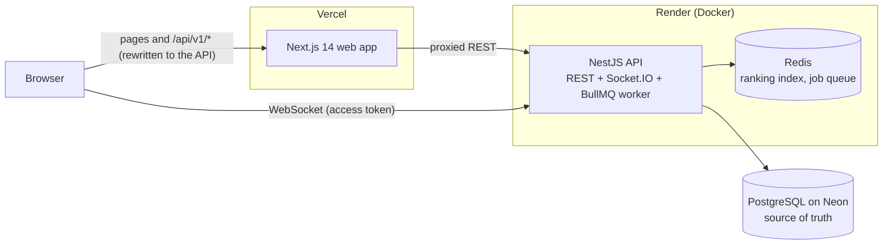

# GameFeatures

[](https://github.com/alikonainofficial/gamefeatures/actions/workflows/ci.yml)
[](LICENSE)

A feature-request board for games. Gamers post ideas for the games they play and upvote the ones they want most; a game's developers see what the community cares about, change a request's status and reply, and everyone involved hears about it in real time.

Built as a TypeScript monorepo: a NestJS API, a Next.js web app, PostgreSQL, Redis and Socket.IO.

## Live demo

**https://gamefeatures.vercel.app**

- On the login page, click **Try as gamer** or **Try as developer** to sign in to a shared demo account with one click (`demo_gamer` / `demo_dev`, password `try-the-demo`). `demo_dev` is the developer of *Portal 2* and can change the status of its requests.
- **The first visit after a quiet spell takes up to a minute.** The API runs on a free Render instance that sleeps after 15 idle minutes; the site shows a "Waking up the free demo server" banner and reloads by itself once the API answers.
- Try it in two browsers: vote on a request in one and watch the count change in the other, or change a request's status as `demo_dev` and watch `demo_gamer`'s notification bell.
- The demo data may be reset, so please don't post anything personal. API docs (Swagger): https://gamefeatures-api.onrender.com/docs

<!-- 🧑 TODO (Ali): add screenshots or a short GIF, e.g. docs/screenshots/request-page.png -->
> 📸 *Screenshots coming soon.*

## Architecture



- **One origin for REST.** The browser only talks to the web app's own domain: Next.js rewrites `/api/v1/*` to the API. The refresh token is an `HttpOnly`, `SameSite=Lax`, host-only cookie, so it works without any cross-site cookie settings. Sockets connect to the API directly and authenticate with the short-lived access token instead.
- **Postgres is the source of truth; Redis is a derived index.** Redis holds the per-game ranking sorted sets and the BullMQ notification queue. Losing Redis loses nothing that can't be rebuilt.
- **Single image, migrate on start.** The API ships as a multi-stage Docker image (`apps/api/Dockerfile`) that runs `prisma migrate deploy` and then the server. Infrastructure is described in [`render.yaml`](render.yaml); the deploy runbook is [`docs/DEPLOY.md`](docs/DEPLOY.md).

## Engineering highlights

- **Self-healing Redis ranking index.** Requests are paged as *Top*, *New* and *Hot* (Reddit's hot formula: log-scaled votes plus a time term) from Redis sorted sets. A game's sets are only read when an "indexed" marker exists, and that marker is written in the same `MULTI` that rebuilds the sets from Postgres, so a half-built index (empty Redis, restart, first write) is never served. The marker expires after an hour to bound drift, and if Redis is down the lists come from Postgres in the same order.
- **Idempotent, race-safe votes.** Votes, comment likes and follows are `PUT`/`DELETE` on a resource rather than toggles. A vote is one transaction (insert the vote, increment the counter); a duplicate hits the unique constraint and returns the current count instead of double-counting, so double clicks and parallel requests can't drift the counters. Tested with concurrent requests.
- **Refresh-token rotation with hashed tokens.** Access tokens live 15 minutes, in memory only. Refresh tokens rotate on every use, are stored as SHA-256 hashes, and are claimed with a single atomic `deleteMany`, so two parallel refreshes with the same cookie get exactly one success.
- **Room-scoped sockets.** Each user's private `user:<id>` room is joined by the server on an authenticated connection only; clients may join nothing but public `request:<id>` rooms (validated by pattern), so nobody can listen in on another user's notifications.
- **Rate limiting that knows about proxies.** A global per-IP limit plus a stricter one on login, register and refresh, with `trust proxy` hops configured for the real chain (browser → Vercel → Render) and verified in production.
- **End-to-end tests against real Postgres and Redis.** 145 Jest e2e tests boot the real Nest app on a random port and talk to it over HTTP and Socket.IO, covering auth, voting races, ranking, notifications, rate limits, the seed script and more. Together with the unit tests they run under an 80% line-coverage floor (currently ~96%).
- **CI that tests what ships.** GitHub Actions runs lint, typecheck, unit, e2e (with coverage) and web tests, then builds the production Docker image, boots it against an empty database, seeds it and runs the production smoke test against the container.

## Tech stack

| Layer | Tools |
|---|---|
| API | NestJS 10, Prisma 5 (PostgreSQL), ioredis, BullMQ, Socket.IO, Passport (JWT, Google, Twitch), Swagger |
| Web | Next.js 14 (App Router), React 18, Tailwind CSS, zustand, socket.io-client |
| Data | PostgreSQL 16, Redis 7 |
| Tooling | pnpm workspaces, Turborepo, TypeScript (strict), ESLint, Jest, Supertest, Vitest |
| Delivery | Docker, GitHub Actions, Render, Vercel, Neon |
| Integrations | RAWG games API (search and import), Firebase Cloud Messaging (optional push) |

## Project structure

```
gamefeatures/
├── apps/
│   ├── api/                  # NestJS API (port 3001)
│   │   ├── src/modules/      # auth, users, games, requests (+ ranking), comments,
│   │   │                     # follows, notifications, admin, health
│   │   ├── test/             # e2e tests and the test harness
│   │   └── Dockerfile        # production image
│   └── web/                  # Next.js web app (port 3000)
│       └── src/              # app/ (routes), components/, lib/ (API client, stores)
├── libs/
│   ├── shared/               # types and constants shared by API and web
│   ├── database/             # Prisma schema, migrations, seed
│   └── redis/                # Redis module
├── docs/DEPLOY.md            # deploy runbook (Neon + Render + Vercel)
├── scripts/                  # smoke test, build checks
├── render.yaml               # Render Blueprint (API + Key Value)
└── docker-compose.yml        # local Postgres and Redis
```

## Getting started

**Prerequisites:** Node.js 20 (18+ works), pnpm 8 (`corepack enable`), Docker. A [RAWG API key](https://rawg.io/apidocs) is optional (it enables searching and importing games).

```bash
git clone https://github.com/alikonainofficial/gamefeatures.git
cd gamefeatures
pnpm install

# Environment files (the defaults work for local development)
cp .env.example .env
cp apps/api/.env.example apps/api/.env
cp apps/web/.env.example apps/web/.env.local
cp libs/database/.env.example libs/database/.env   # read by the Prisma CLI

# Postgres and Redis
docker compose up -d

# Database
pnpm db:generate
pnpm db:migrate      # apply migrations
pnpm db:seed         # sample games, requests and the demo accounts

# Run API + web (the libraries are built first)
pnpm dev
```

- Web app: http://localhost:3000
- API: http://localhost:3001
- Swagger: http://localhost:3001/docs

Schema changes go through migrations: edit `libs/database/prisma/schema.prisma`, run `pnpm db:migrate` and name the migration. Production applies them with `prisma migrate deploy`. `pnpm db:push` is only for throwaway prototyping. If a local database was created with `db:push` before migrations existed, `db:migrate` reports drift and offers to reset it (this deletes local data; run `db:seed` afterwards).

## Demo accounts (after seeding)

`pnpm db:seed` creates two demo accounts whose password is `SEED_DEMO_PASSWORD` (default `try-the-demo`, intentionally public):

| Username | Email | Role |
|----------|-------|------|
| demo_gamer | demo_gamer@demo.gamefeatures.dev | Gamer |
| demo_dev | demo_dev@demo.gamefeatures.dev | Developer for Portal 2 |

No admin is created by default. Set `SEED_ADMIN_EMAIL` and `SEED_ADMIN_PASSWORD` (at least 16 characters in production) to create one. The seed is idempotent: run it as often as you like. It never writes to Redis; the ranking index rebuilds itself.

## Testing

```bash
pnpm lint          # ESLint, API and web
pnpm typecheck     # tsc --noEmit everywhere
pnpm test          # API unit tests (Jest) + web tests (Vitest)
pnpm test:e2e      # API end-to-end tests against real Postgres and Redis

# e2e with the coverage report and the 80% line threshold, as CI runs it
pnpm --filter @game-review/api test:e2e --coverage
# one e2e file
pnpm --filter @game-review/api test:e2e test/requests

# production smoke test against any deployment (needs curl and jq)
pnpm smoke https://gamefeatures.vercel.app
```

- **E2E tests** need Postgres and Redis (`docker compose up -d`). They use the `game_review_test` database and Redis DB 1, from `apps/api/test/.env.test`, and refuse to run against a database whose name doesn't end in `_test`. Each test starts from empty tables, an empty Redis DB, drained queues and fresh rate-limit counters.
- **Coverage** is collected from services, `common/` and the ranking code; CI fails under 80% lines.
- **The smoke test** checks health, the game and request lists, login, `/auth/me`, a vote and unvote (restoring the original state), a cookie refresh and logout, through the web app's origin like a browser.

## API overview

Full, interactive reference: Swagger at `/docs` ([live](https://gamefeatures-api.onrender.com/docs)). All routes are under `/api/v1`.

| Area | Routes |
|---|---|
| Health | `GET /health` |
| Auth | `POST /auth/register`, `/auth/login`, `/auth/refresh`, `/auth/logout` · `GET /auth/me` · OAuth: `GET /auth/oauth/google`, `/auth/oauth/twitch` |
| Games | `GET /games`, `/games/:slug`, `/games/:slug/requests?sort=hot\|top\|new` · `GET /games/search/rawg` · `POST /games/import/:externalId` |
| Requests | `POST /requests` · `GET /requests/:id` · `PUT`/`DELETE /requests/:id/vote` · `PATCH /requests/:id/status` (the game's developer) |
| Comments | `GET`/`POST /requests/:requestId/comments` · `PUT`/`DELETE /comments/:id/like` |
| Users & follows | `GET /users/:username`, `/users/:username/requests`, `/users/me/feed` · `PATCH /users/me` · `PUT`/`DELETE /follows/users/:userId`, `/follows/games/:gameId` · followers/following lists |
| Notifications | `GET /me/notifications` · `PATCH /me/notifications/:id/read` · `POST /me/notifications/read-all` · `POST /me/device-tokens` |
| Admin | `POST /admin/games/:gameId/grant-access` · `DELETE /admin/games/:gameId/revoke-access` · `GET /admin/games/with-dev-access` · `POST /admin/users/:userId/make-admin` |

Real-time events use the Socket.IO namespace `/notifications`.

## Environment variables

Each app documents its variables in its `.env.example`. The main ones:

**API** (`apps/api/.env`)

| Variable | Default (local) | Notes |
|---|---|---|
| `DATABASE_URL` | local Postgres | Runtime connection. On Neon, the **pooled** URL. |
| `DIRECT_URL` | same as `DATABASE_URL` | Used by `prisma migrate`. On Neon, the **direct** URL. |
| `REDIS_URL` | `redis://localhost:6379` | |
| `JWT_SECRET`, `JWT_REFRESH_SECRET` | dev values | Use long random strings in production. |
| `WEB_URL` | `http://localhost:3000` | Web origin(s), comma-separated: CORS, socket CORS, OAuth redirect (first entry). |
| `API_URL` | `http://localhost:3001` | Public base URL for OAuth callbacks (the web URL when proxied). |
| `PORT` | `3001` | |
| `TRUST_PROXY_HOPS` | `0` | Proxies in front of the API (`2` in production: Vercel + Render). |
| `THROTTLE_TTL_MS`, `THROTTLE_LIMIT` | `60000`, `100` | Global per-IP rate limit. |
| `AUTH_THROTTLE_LIMIT`, `AUTH_THROTTLE_TTL_MS` | `10`, `60000` | Login, register and refresh. |
| `LOG_CLIENT_IP` | `false` | Logs the resolved client IP per request, to verify `TRUST_PROXY_HOPS`. |
| `RAWG_API_KEY`, `RAWG_TIMEOUT_MS` | unset, `5000` | Optional game search and import. |
| `GOOGLE_*`, `TWITCH_*`, `FIREBASE_*` | unset | Optional OAuth and push notifications. |

**Web** (`apps/web/.env.local`; read at build time)

| Variable | Default (local) | Notes |
|---|---|---|
| `API_ORIGIN` | `http://localhost:3001` | Where `/api/v1/*` is proxied to. |
| `NEXT_PUBLIC_SOCKET_URL` | `http://localhost:3001` | Socket.IO connects here directly. |
| `NEXT_PUBLIC_DEMO_MODE` | `false` | Cold-start banner, one-click demo logins, footer note. |
| `NEXT_PUBLIC_DEMO_PASSWORD` | `try-the-demo` | Must match `SEED_DEMO_PASSWORD`. |
| `NEXT_PUBLIC_OAUTH_PROVIDERS` | unset | `google,twitch` to show those buttons (unset: shown, except in demo mode). |
| `NEXT_PUBLIC_API_URL` | `/api/v1` | Override the REST base URL (bypassing the proxy breaks the cookie in production). |

**Seed** (`pnpm db:seed`): `SEED_DEMO_PASSWORD`, and optionally `SEED_ADMIN_EMAIL`, `SEED_ADMIN_PASSWORD`, `SEED_ADMIN_USERNAME`.

## Deployment

The live demo runs entirely on free tiers: **Vercel** (web), **Render** (API Docker image and Redis) and **Neon** (Postgres). [`docs/DEPLOY.md`](docs/DEPLOY.md) has the step-by-step runbook, the pre-deploy checklist, every environment variable, and the rollback plan. Render deploys a commit only after its CI checks pass.

## Troubleshooting

- **"Cannot find module '@game-review/…'"**: build the libraries: `pnpm build --filter=@game-review/shared --filter=@game-review/database --filter=@game-review/redis`.
- **Database connection failed**: check `docker compose ps`; restart with `docker compose down && docker compose up -d`.
- **Port already in use**: `lsof -i :3001` (or `:3000`), then stop that process.

## Known limitations

- **Free-tier cold starts.** The demo API sleeps after 15 idle minutes and takes about a minute to wake; Neon's database also scales to zero (a few seconds to resume).
- **Single instance.** Socket.IO rooms and the BullMQ worker assume one API instance; scaling out would need the Socket.IO Redis adapter.
- **No refresh-token reuse detection.** Refresh tokens rotate and are stored hashed, but a stolen token that is used *before* the real user refreshes isn't detected. Reuse detection (revoking the whole session family when an old token reappears) is out of scope: it would also log out every tab when two tabs refresh at the same moment.
- **OAuth and push notifications are off in the demo.** Google/Twitch login and Firebase push work when configured, but the demo has no credentials for them.
- **Per-IP limits assume traffic comes through the web app.** Someone calling the API's own URL directly can forge part of `X-Forwarded-For` and spread requests across fake IPs. A shared secret between Vercel and the API would close this.
- **Redis on the free tier is in-memory.** A restart drops queued notification jobs that hadn't run yet (rankings rebuild themselves).
- No email verification or password reset.

## License

[MIT](LICENSE) © 2026 Ali Konain
